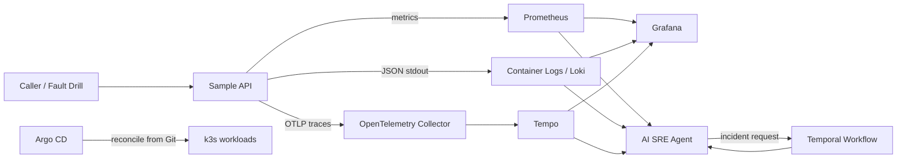

# Staff SRE Platform Assessment

A local, GitOps-managed SRE platform reference implementation for the Intuitive Technology Partners Staff Infrastructure & SRE assessment. It combines k3s, Argo CD, Prometheus, Grafana, Loki, Tempo, an instrumented FastAPI service, Temporal, and a telemetry-backed AI SRE investigator.

> **Status:** implementation scaffold; local cluster bootstrap and end-to-end execution must be verified on your machine. This repository does not claim a successful cluster run until `scripts/validate.sh` and the incident drill have been executed.

## Architecture



## Repository layout

- `bootstrap/`: one-time local k3s and Argo CD bootstrap boundary.
- `gitops/`: desired Kubernetes state reconciled by Argo CD after bootstrap.
- `services/sample-api/`: API with health endpoints, Prometheus metrics, JSON logs, OpenTelemetry traces, and guarded fault injection.
- `services/ai-sre-agent/`: telemetry query client and structured RCA endpoint.
- `services/temporal-worker/`: Temporal workflow and activity worker.
- `tests/`: unit tests for the API and RCA logic.
- `scripts/`: bootstrap, validation, and controlled incident drill.
- `AI_INTERACTION_LOG.md`: development interaction log; append actual sessions and preserve full transcripts separately as required.

## Prerequisites

Linux recommended; 4 CPU cores and 12–16 GiB RAM recommended for the full local stack. Install `git`, `curl`, `python3`, `docker` (or another supported image builder), `kubectl`, and `helm`. k3s installs Kubernetes components itself. The full observability and Temporal stack is resource-intensive; adjust requests and chart values to the machine.

## Bootstrap

1. Fork or create a public repository named `staff-sre-platform-assessment` and push this source.
2. Update `gitops/root/platform-root.yaml` to point to your actual repository URL and branch.
3. Run `sudo ./bootstrap/install-k3s.sh` on a disposable local Linux host. This script installs k3s only.
4. Set `KUBECONFIG=/etc/rancher/k3s/k3s.yaml` (copy it to your user account with restrictive permissions if needed).
5. Run `./bootstrap/bootstrap-argocd.sh`. This is the documented one-time bootstrap boundary: it installs Argo CD and creates the root Application. After this step, application and platform workloads must be changed through Git and reconciled by Argo CD.
6. Watch reconciliation: `kubectl get applications -n argocd` and `kubectl get pods -A`.
7. The bootstrap script creates local-only secrets and stores their values in `.local-secrets.env`, which is gitignored. Protect that file. In a production design, use an approved secrets manager / External Secrets integration instead.

Do not expose Argo CD or Grafana publicly for this local assessment. Use port-forwarding for access.

## Local development and tests

```bash
python3 -m venv .venv
. .venv/bin/activate
pip install -r services/sample-api/requirements.txt
pip install -r services/ai-sre-agent/requirements.txt -r requirements-dev.txt
pytest -q
```

Build and publish images with `scripts/build-push-images.sh`. First authenticate to GHCR interactively or with a short-lived token via `docker login ghcr.io`; never place the token in Git. Set `REGISTRY` and `TAG` if needed. Update image references in GitOps manifests to the actual published images and preferably immutable digests before syncing. Do not use `latest` for a reviewed release.

## Incident drill

Once Argo CD reports the API and observability components healthy:

```bash
./scripts/simulate-incident.sh http://127.0.0.1:18080 http://127.0.0.1:18081
```

The first URL is the API port-forward and the second is the AI SRE agent port-forward. The API deployment has fault injection disabled by default. For the isolated assessment only, enable it through a reviewed Git change (`FAULT_INJECTION_ENABLED=true`), sync through Argo CD, and set `FAULT_INJECTION_TOKEN` from `.local-secrets.env` in your shell. The drill sends test traffic, requests RCA, and saves the response under `artifacts/`. Review the evidence in the returned report. The script intentionally does not kill arbitrary pods.

## Temporal workflow execution

Port-forward the Temporal frontend to `7233`, install `services/temporal-worker/requirements.txt` in a local virtual environment, and run:

```bash
PYTHONPATH=services/temporal-worker python scripts/start_temporal_workflow.py --temporal-address 127.0.0.1:7233 --window-seconds 900 --wait
```

The worker deployment must be healthy and subscribed to `sre-incident-analysis`. The starter is a client, not a replacement for the worker. Capture the actual workflow result and Temporal logs as assessment evidence.

## Access services with port-forwarding

Commands depend on the selected Helm chart release names. Typical local-only examples:

```bash
kubectl -n observability port-forward svc/platform-grafana 3000:80
kubectl -n apps port-forward svc/sample-api 18080:8080
kubectl -n apps port-forward svc/ai-sre-agent 18081:8081
```

Confirm service names with `kubectl get svc -A`; do not assume chart-generated names without checking.

## SLI, SLO, and alert

The API exports request count and latency histograms. `gitops/observability/` contains Prometheus rule examples for successful-request ratio and elevated 5xx responses. The example 99% success SLO is illustrative, not a claim of achieved availability. For a real production SLO, define the eligible request population, exclusions, measurement window, and alerting policy with service owners.

## Security notes and known limitations

- Fault injection is disabled by default and requires a token; use it only in an isolated test environment.
- The AI agent is read-only. It queries telemetry and recommends actions; it does not run `kubectl`, restart workloads, or mutate infrastructure.
- Secret values are not committed. Use Kubernetes Secrets only for local experiments; use an approved external secret manager for production.
- NetworkPolicy enforcement depends on the installed CNI. Verify that the selected k3s networking configuration enforces policies before relying on them.
- The single-node local cluster does not prove high availability, multi-AZ behavior, disaster recovery, or production-scale capacity.
- Chart versions and images must be reviewed and pinned before final submission.
- The Temporal local deployment uses PostgreSQL as its persistence store; validate schema initialization and workflow execution after bootstrap.
- LLM output is advisory and must be grounded in query evidence. If no LLM key is configured, the agent uses a deterministic rules-based fallback.

## Day-2 runbooks

See `docs/operations.md`, `docs/security.md`, and `docs/incident-runbook.md`.

## Roadmap

1. Run a clean-room bootstrap and save test evidence.
2. Pin all image digests and chart versions; add image scanning and SBOM generation.
3. Add alert delivery to a test receiver and test notification routing.
4. Add workload-level network policies and validate them with connectivity tests.
5. Add Temporal persistence/restore drills and documented backup retention.
6. Load-test the API and derive resource requests from observed usage.
7. Port the design to EKS with IRSA, multi-AZ node groups, managed secrets, encrypted persistent storage, and an approved DR plan.

## AI usage disclosure

The assessment requires a complete AI interaction log. `AI_INTERACTION_LOG.md` contains a starter index and must be updated with the actual tools, prompts, outputs, and decisions used during development. Do not claim a transcript is complete unless it is actually captured. Redact secrets and personal data.
